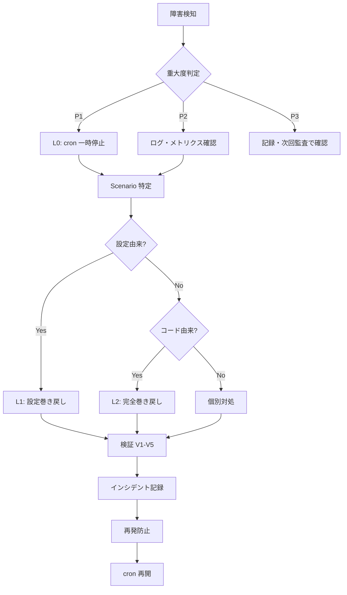

# MID 障害対応フロー（fault_response_flow）

## 1. 目的と適用範囲

本ドキュメントは、MID（Morning Intelligence Digest）の運用中に発生し得る障害を **Scenario として catalogue 化**し、それぞれの検知方法・初動対応・根本原因調査・再発防止を定める。対象は Phase 5（Operational Readiness）以降の全障害対応とする。

監視の具体は [[monitoring_design]] 、退回しは [[rollback_plan]] 、定期試験は [[e2e_test_plan]] を参照。

## 2. 重大度定義

[[monitoring_design]] §6 のアラートルールに対応する。

| 重大度 | 定義 | 初動時間 | 通知 |
|---|---|---|---|
| P1 | データ破損・ログ証跡の断絶・非有限値検出 | 15 分以内 | オーナー（telegram 等） |
| P2 | 機能の部分停止（重み更新失敗・cron 失敗） | 1 時間以内 | オーナー |
| P3 | 性能劣化・軽微な変動 | 次回監査 | 記録のみ |

### 2.1 重大度の判定基準

```
非有限値（NaN/Inf）検出
LOG 書込失败が 30 分継続
  → P1

load_*_error / save_*_error が 1 件でも出た
consecutive_failures が threshold の 80% に到達
  → P2

clip 境界への新規張り付き
last_success の陳腐化
日次処理行数の急変
  → P3
```

## 3. 障害対応の基本フロー



実際の手順は [[rollback_plan]] §4 に従う。本フローの役割は「どの Scenario か」「どの層まで戻すか」を判断することにある。

## 4. Scenario カタログ

### Scenario 1: 非有限値（NaN / Inf）の混入

| 項目 | 内容 |
|---|---|
| 重大度 | P1 |
| 症状 | `base_weight` が `nan` / `inf` になる |
| 検知 | 監視 validator（[[monitoring_design]] §3.3）、`assert math.isfinite()` |
| 主因 | `feedback_rules.yaml` の delta 誤編集、外部からの直接書き換え |
| ログサイン | `update_health_metrics` の metadata に `nan` |

**初動対応**:

1. `hermes cron pause mid-morning-digest` （L0）
2. `source_weights.yaml` をバックアップから復元（[[rollback_plan]] §4.2）
3. validator で全 source の有限性を確認
4. `Memory/Configs` への直接編集を禁止する旨を Vault の変更履歴に記録

**根本原因調査**: `backups/failed_<TS>/` と正常版の diff を取り、どの行が変更されたかを特定する。

**再発防止**: `validate_configs.py`（2026-11-20 導入）が非有限値・clip 範囲・delta 許容範囲を CI gate として検出する。

### Scenario 2: フィードバック二重適用による重み変動

| 項目 | 内容 |
|---|---|
| 重大度 | P2 |
| 症状 | 1 件のフィードバックで重みが 2 回分変動する |
| 検知 | `process_feedback_log_success` 数 vs 入力行数の不整合 |
| 主因 | `save_weights()` が行ループ内で呼ばれ、同一セッションで重複保存される実装（[[monitoring_design]] §4.1 参照） |
| ログサイン | `weight_updated` が同一 `correlation_id` で複数回 |

**初動対応**:

1. 直近の JSONL フィードバックログを確認し、対象 source の変動量を特定
2. 変動量が delta の整数倍である場合、余剰分を手動で戻す（**直接編集は最後の手段**）
3. 必要に応じて L1

**根本原因調査**: `process_feedback_log()` の呼び出し回数をセッション単位でログに記録する。

**再発防止**: `save_weights()` をループ外へ移動するリファクタを Phase 6 で実施。

### Scenario 3: ログ出力先の散乱 / 書込失敗

| 項目 | 内容 |
|---|---|
| 重大度 | P1（30 分継続時）/ P2（単発） |
| 症状 | `Memory/Feedback/logs/` 以外に `log_*.jsonl` が生成される |
| 検知 | `logger.get_log_path()` の返り値、ファイル散乱チェック |
| 主因 | OneDrive の「オンンデマンド」設定によるファイル欠落、CWD 相対パスの解決失敗 |
| ログサイン | `get_log_path` の fallback が `OneDrive/Vault` ルート以外を指す |

**初動対応**:

1. OneDrive の Vault ルートを「常にこのデバイスに保持する」に設定
2. `find "$HOME" -name "log_*.jsonl" -not -path "*/Feedback/logs/*"` で散乱ファイルを列挙
3. 散乱ファイルを `logs/` へ移動（**削除しない**）
4. Vault 外（`$TMPDIR` 等）のログは削除してよい

**根本原因調査**: `paths.yaml` の `base_path` が相対パスのままか、CWD が `$HOME` 以外で実行されたかを確認（[[deployment_procedures]] §2.3 R1）。

**再発防止**: cron に `--workdir "$HOME"` を必須化。

### Scenario 4: `sources` の list/dict 不整合（**Critical**）

| 項目 | 内容 |
|---|---|
| 重大度 | P2（本番投入前は **Release Blocker**） |
| 症状 | `update_health_metrics('gov_official', True)` が `{'status': 'error', 'message': 'Source ID not found'}` を返す |
| 検知 | `type(sources).__name__ == 'list'` |
| 主因 | `source_weights.yaml` が list 形式で記述されている |
| ログサイン | `weights_file_missing` 相当の沈黙した failure |

**初動対応**:

1. `source_weights.yaml` を dict 形式に是正する（list の各要素の `id` をキーにする）
2. 是正後、`update_health_metrics('gov_official', True)` で `{'status': 'success'}` を確認
3. 既存の list 版は `backups/failed_<TS>/` へ退避

> **2026-11-20 更新**: `weight_manager.load_weights()` が list 形式を検出すると
> dict へ自動正規化する（`sources_list_detected` ログ発火）。そのため設定の
> 巻き戻し（L1）で復元可能。障害がコード変更に起因する場合は L2
> （`code_rollback.py restore`、[[rollback_plan]] §4.3）でコードまで巻き戻す。

**dict 化の例**:

```yaml
# Before (list)
sources:
  - id: gov_official
    base_weight: 1.0
# After (dict)
sources:
  gov_official:
    id: gov_official
    base_weight: 1.0
```

**根本原因調査**: 誰が・いつ・どの手段で YAML を編集したかを Vault の変更履歴から追跡。

**再発防止**: 設定編集を `feedback_processor` 経由に限定し、直接編集には validator を必須化。

### Scenario 5: CWD 依存パスによる静かな失敗（R1）

| 項目 | 内容 |
|---|---|
| 重大度 | P2 |
| 症状 | `load_weights()` が空の `{"sources": {}}` を返す。エラーにならないため気づきにくい |
| 検知 | スモークテストで `gov base_weight` が出ない |
| 主因 | `$HOME` 以外から実行すると `paths.yaml` の相対解決が失敗する |
| ログサイン | `config_load_error`、または `weights_file_missing` |

**初動対応**:

1. `cd "$HOME"` してから再実行
2. cron の `--workdir "$HOME"` が外れていないか確認
3. もし空の重みセットで処理が走った場合、その結果は破棄し再実行

**再発防止**: `mid_daily_run.py` の先頭で `os.chdir(os.path.expanduser("~"))` を実施するか、パス解決を絶対パス化する。

### Scenario 6: フィードバック解析失敗の未検知（B6）

| 項目 | 内容 |
|---|---|
| 重大度 | P3（データ損失の可能性があるため P2 に昇格の余地） |
| 症状 | 処理行数と `process_feedback_log_success` 数が不整合 |
| 検知 | [[monitoring_design]] §4.1 B2 の突合 |
| 主因 | `json.loads` 失敗時に `continue` する実装（ログは残るが後続処理が止まる場合がある） |
| ログサイン | `json_decode_error` |

**初動対応**:

1. `json_decode_error` の行番号を特定し、該当行を修正 or 削除
2. 修正後の JSONL で `process_feedback_log` を再実行
3. 処理行数と成功数が一致することを確認

**再発防止**: DEAD_LETTER 出力（`logs/dead_letter_<TS>.jsonl`）を導入し、解析失敗行を退避する。

### Scenario 7: cron 実行失敗 / 滞留

| 項目 | 内容 |
|---|---|
| 重大度 | P2 |
| 症状 | `hermes cron runs mid-morning-digest` の status が `error` |
| 検知 | `hermes cron runs`、`--failure-deliver` 通知 |
| 主因 | インタプリタ不在（`py -3.10`）、依存モジュールの `ModuleNotFoundError`、タイムアウト |
| ログサイン | Hermes 側の実行ログ（Vault 外） |

**初動対応**:

1. `hermes cron runs mid-morning-digest` で失敗理由を確認
2. `py -3.10 --version` と `py -3.10 -c "import yaml"` を検証
3. `hermes cron run mid-morning-digest` で即時再実行
4. 失敗が継続する場合は [[rollback_plan]] §4.3（L2: `code_rollback.py restore`）

**再発防止**: ランナースクリプトの先頭で環境チェックを入れ、失敗時は即座に nonzero exit とする。

### Scenario 8: `feedback_rules.yaml` の clip range 破損

| 項目 | 内容 |
|---|---|
| 重大度 | P1 |
| 症状 | `weight_min >= weight_max` となり、clip が常に境界値を返す |
| 検知 | validator の `assert r["weight_min"] < r["weight_max"]` |
| 主因 | ルール誤編集 |
| ログサイン | 重みが一方的に増加 or 減少し続ける |

**初動対応**: L1（[[rollback_plan]] §4.2）。設定の直接編集を禁止する。

**再発防止**: `scripts/validate_feedback_rules.py`（2026-11-20 導入）が
`weight_min < weight_max`・確率範囲（0.0〜1.5）・delta 上限（±1.0）を CI gate として検出する。

## 5. エスカレーション

| 重大度 | 一次対応 | 二次対応 | エスカレーション先 |
|---|---|---|---|
| P1 | 当直（オーナー） | オーナー＋技術顾问 | telegram 等（Phase 6） |
| P2 | オーナー（24h 以内） | オーナー | 記録のみ |
| P3 | 次回監査 | — | — |

**エスカレーション条件**: 同一 Scenario が 1 週間以内に 2 回以上発生した場合、P3 であっても P2 へ昇格させ根本原因の徹底調査を行う。

## 6. インシデント記録テンプレート

障害発生時は以下のテンプレートで `Memory/Sessions/` に記録する。

```markdown
## インシデントレポート: <title>

- **日時**: YYYY-MM-DD HH:MM (JST)
- **重大度**: P1 / P2 / P3
- **Scenario**: S1〜S8 のいずれか
- **影響範囲**: 配信停止 / 重み異常 / ログ欠損 など
- **検知方法**: cron status / 監視 validator / 手動
- **初動対応**: L0 / L1 / L2
- **根本原因**:
- **再発防止**:
- **所要時間**:
```

## 7. ドリル・訓練

| 頻度 | 内容 |
|---|---|
| 月 1 回 | Scenario 4（list/dict 不整合）の再現と是正 |
| 四半期 1 回 | Scenario 3（ログ散乱）の初動 |
| 年 1 回 | Scenario 1（非有限値）の全工程（P1 想定） |

訓練結果は [[e2e_test_plan]] §9 の障害注入テストとしても活用する。

## 8. 既知のギャップ

| # | 内容 | 深刻度 | 対処 |
|---|---|---|---|
| G1 | `json_decode_error` 後の DEAD_LETTER 未実装 | Medium | Phase 6 |
| G2 | validator が未製品化（[[monitoring_design]] §9-4 参照） | ~~High~~ 解消済 | 2026-11-20: `validate_configs.py`（設定）・`scripts/validate_feedback_rules.py`（clip）・`validate_log_integrity.py`（ログ）を導入 |
| G3 | 自動通知の未実装（`--failure-deliver local` 止まり） | Medium | Phase 6 で telegram 連携 |
| G4 | Scenario 4 の根本是正 | ~~Critical~~ Medium | 2026-11-20: `load_weights()` が list→dict 正規化、`validate_configs.py` が CI gate で list を検出。本番は dict 維持 |

---
*Phase 5 運用開始時ドキュメント / インシデント発生時は都度 updated と変更履歴を更新すること。*
